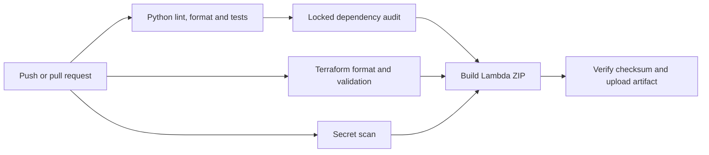
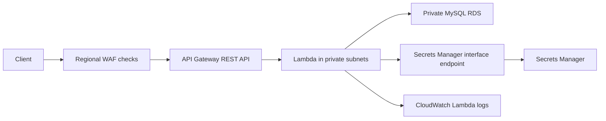

# Serverless API and CI Pipeline

A small AWS Lambda API with Terraform templates and a credential-free CI pipeline.
The API reads the current time from MySQL. The pipeline checks code and dependencies,
validates Terraform and builds a Lambda ZIP only after those checks pass.

## Run the checks

Use Python 3.12 and Terraform 1.11.2. No AWS credentials are needed for these checks.

```bash
python3 -m venv .venv
source .venv/bin/activate
python -m pip install -r requirements-dev.txt
python -m pip install --require-hashes -r lambda/requirements.txt
ruff check .
ruff format --check .
pytest
terraform -chdir=infra init -backend=false
terraform -chdir=infra validate
```

## Pipeline



GitHub Actions uses read-only repository permissions and actions pinned to verified
commit SHAs. A failed test, dependency audit or secret scan blocks the build.
Runtime dependencies are hash-locked separately from development tools.

The pipeline does not apply Terraform or access an AWS account. Deployment remains
a deliberate manual step. This is CI and artifact delivery, not automatic cloud
rollout or a claim of zero downtime.

## Build the artifact

```bash
python scripts/build_lambda.py
```

The builder installs the locked runtime wheels for Linux x86_64 and Python 3.12
into temporary staging. It copies only the handler from the source folder, then
writes `build/lambda.zip` and `build/lambda.zip.sha256`. Tests, caches and environment
files are excluded. CI keeps its artifact for seven days.

## What the tests cover

- A successful query and timezone-aware response.
- Secret access failure, database failure and an empty query result.
- Closing the database connection after both success and query failure.
- Keeping internal exception details out of responses and logs.
- The smoke command against a real local HTTP server, including HTTP 500 and
  invalid HTTP 200 responses. Failure must return a nonzero exit status.
- ZIP contents and its SHA256 companion file.

Cloud services are mocked in unit tests. The local HTTP server uses fictional
responses. These checks do not prove a live RDS, WAF or API Gateway deployment.

## Infrastructure template



The template includes a private MySQL database and a Secrets Manager interface
endpoint so the private Lambda has a route to its credentials without NAT.
The secret uses separate host and port values. Lambda uses the runtime-provided
AWS_REGION variable. API stage creation is explicit.

API access logging is off by default. Enable it only after configuring the
regional API Gateway CloudWatch role. The template does not change that shared
account setting. [Deployment guide](DEPLOYMENT_GUIDE.md).

## Support demonstration

Read the [incident cases](docs/support-cases.md) and
[interview guide](docs/interview-guide.md). Explain the symptom, failed check,
next investigation and verification. Keep fictional incidents separate from work
experience.

To test an authorised deployed API:

```bash
./test-api.sh https://YOUR_API_ID.execute-api.YOUR_REGION.amazonaws.com/prod
```

This performs a bounded GET check. It does not send attack payloads or load tests.

## Deployment boundary

The templates and offline checks are maintained here. The revised infrastructure
has not been deployed as part of this update. Before a live lab deployment,
review costs, account permissions, database TLS trust and Terraform state storage.
This public time endpoint has no application authentication.

Terraform state can contain generated credentials. Keep it in an approved,
encrypted and access-controlled state backend. Never commit it or a plan file.

## Files

| Path | Purpose |
| --- | --- |
| `lambda/` | Handler, baseline tests and runtime dependency lock |
| `scripts/` | Build and endpoint verification |
| `tests/` | Failure, HTTP and artifact regression tests |
| `infra/` | Terraform and provider lock |
| `.github/workflows/ci.yml` | Credential-free checks and artifact delivery |
| `docs/` | Design decision, support cases and validation evidence |

## Next steps

Verify the revised template in an authorised disposable AWS lab, add a database
TLS trust bundle and demonstrate recovery with a previous approved artifact.
These are future tasks, not completed deployment claims.
