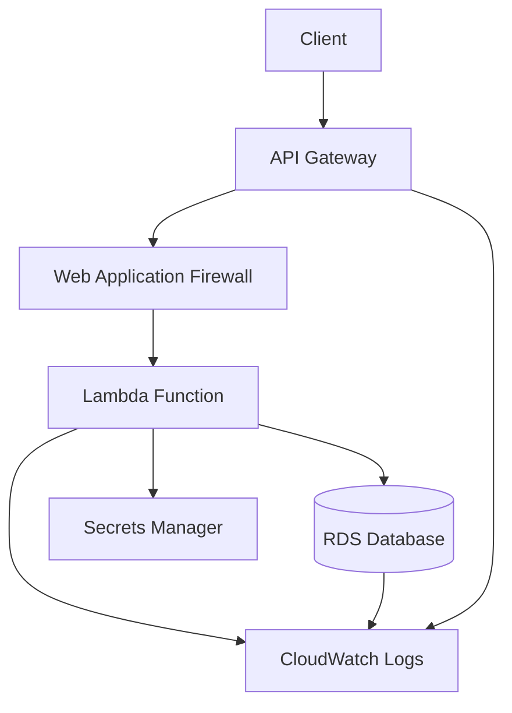

# Serverless Secure Web App (AWS + Terraform)

This project demonstrates a secure serverless architecture on AWS using Terraform. It deploys a web API backed by AWS Lambda and RDS, with strict security measures including least-privilege IAM, AWS WAF, and Secrets Manager integration.

## Architecture

- **API Gateway** - public HTTPS endpoint (protected by WAF)
- **AWS Lambda** - backend compute, minimal IAM role
- **RDS (MySQL/Postgres)** - private subnet, encrypted, not publicly accessible
- **AWS Secrets Manager** - manages DB credentials securely
- **CloudWatch** - centralized logging and metrics



## Security Measures

- Lambda IAM role restricted to `secretsmanager:GetSecretValue` and `rds-db:connect`
- RDS in private subnet, encrypted with AWS KMS
- API Gateway protected by AWS WAF (OWASP ruleset)
- All sensitive values stored in Secrets Manager (never hardcoded)
- CloudWatch logging enabled for API Gateway and Lambda
- VPC isolation with public/private subnet architecture

## Prerequisites

- AWS account with CLI access
- Terraform >= 1.5 installed
- Python 3.9+ with pip
- AWS CLI configured with appropriate permissions

## Quick Start

### 1. Clone and Setup

```bash
git clone https://github.com/yourusername/serverless-secure-webapp.git
cd serverless-secure-webapp
```

### 2. Deploy Infrastructure

```bash
chmod +x deploy.sh
./deploy.sh
```

### 3. Test the API

After deployment, you'll get an API Gateway URL. Test it with:

```bash
curl https://<api_gateway_url>/prod/time
```

Expected response:
```json
{
  "message": "Successfully retrieved time from database",
  "time": "2025-01-03 12:34:56",
  "timestamp": "2025-01-03T12:34:56.789Z"
}
```

## Manual Deployment

If you prefer manual deployment:

```bash
cd infra
terraform init
terraform plan
terraform apply
terraform output
```

## Project Structure

```
serverless-secure-webapp/
├── infra/                    # Terraform infrastructure
│   ├── main.tf              # Main infrastructure resources
│   ├── variables.tf         # Input variables
│   └── outputs.tf           # Output values
├── lambda/                   # Lambda function code
│   ├── app.py               # Main Lambda handler
│   └── requirements.txt     # Python dependencies
├── deploy.sh                # Deployment script
├── .gitignore              # Git ignore rules
└── README.md               # This file
```

## Configuration

### Environment Variables

The Lambda function uses these environment variables:
- `DB_SECRET`: Name of the Secrets Manager secret containing DB credentials
- `AWS_REGION`: AWS region for the deployment

### Terraform Variables

Key variables you can customize in `infra/variables.tf`:

```hcl
variable "aws_region" {
  description = "AWS region for resources"
  default     = "us-east-1"
}

variable "db_engine" {
  description = "Database engine (mysql or postgres)"
  default     = "mysql"
}

variable "db_instance_class" {
  description = "Database instance class"
  default     = "db.t3.micro"
}
```

## Monitoring and Logs

### CloudWatch Logs

- Lambda logs: `/aws/lambda/serverless-secure-webapp-api`
- API Gateway logs: `/aws/apigateway/serverless-secure-webapp-api`

### CloudWatch Metrics

- WAF metrics: Available in CloudWatch under "AWS/WAFV2"
- Lambda metrics: Function duration, errors, invocations
- RDS metrics: Database performance and health

## Testing

### API Endpoints

- `GET /prod/time` - Returns current database time

### Security Testing

Test WAF protection:
```bash
curl "https://<api_gateway_url>/prod/time?test=<script>alert('xss')</script>"
```

## Cleanup

To destroy all resources:

```bash
cd infra
terraform destroy
```

**Warning**: This will permanently delete all resources including the database.

## Troubleshooting

### Common Issues

1. **Lambda timeout**: Check VPC configuration and security groups
2. **Database connection failed**: Verify RDS is in private subnet and security groups allow Lambda access
3. **Secrets Manager access denied**: Check Lambda IAM role permissions
4. **WAF blocking requests**: Check WAF logs in CloudWatch

### Debug Commands

```bash
# Check Lambda logs
aws logs tail /aws/lambda/serverless-secure-webapp-api --follow

# Check API Gateway logs
aws logs tail /aws/apigateway/serverless-secure-webapp-api --follow

# Test database connectivity
aws rds describe-db-instances --db-instance-identifier serverless-secure-webapp-db
```

## What I Learned

- How to design and secure a serverless architecture
- Using least-privilege IAM roles for Lambda functions
- Integrating Secrets Manager instead of hardcoding credentials
- Protecting APIs with WAF against common attacks
- Automating serverless deployments with Terraform
- VPC configuration for secure database access
- CloudWatch logging and monitoring setup

## Next Improvements

- Add CI/CD pipeline with GitHub Actions
- Add multi-environment deployments (dev/staging/prod)
- Extend API with more endpoints and validation
- Add API authentication (Cognito)
- Implement custom domain with SSL certificate
- Add automated testing
- Set up CloudWatch alarms and notifications
- Add API documentation with OpenAPI/Swagger

## License

This project is licensed under the MIT License.

## Contributing

1. Fork the repository
2. Create a feature branch (`git checkout -b feature/amazing-feature`)
3. Commit your changes (`git commit -m 'Add some amazing feature'`)
4. Push to the branch (`git push origin feature/amazing-feature`)
5. Open a Pull Request

## Support

If you have any questions or issues, please open an issue on GitHub or contact the maintainers.
