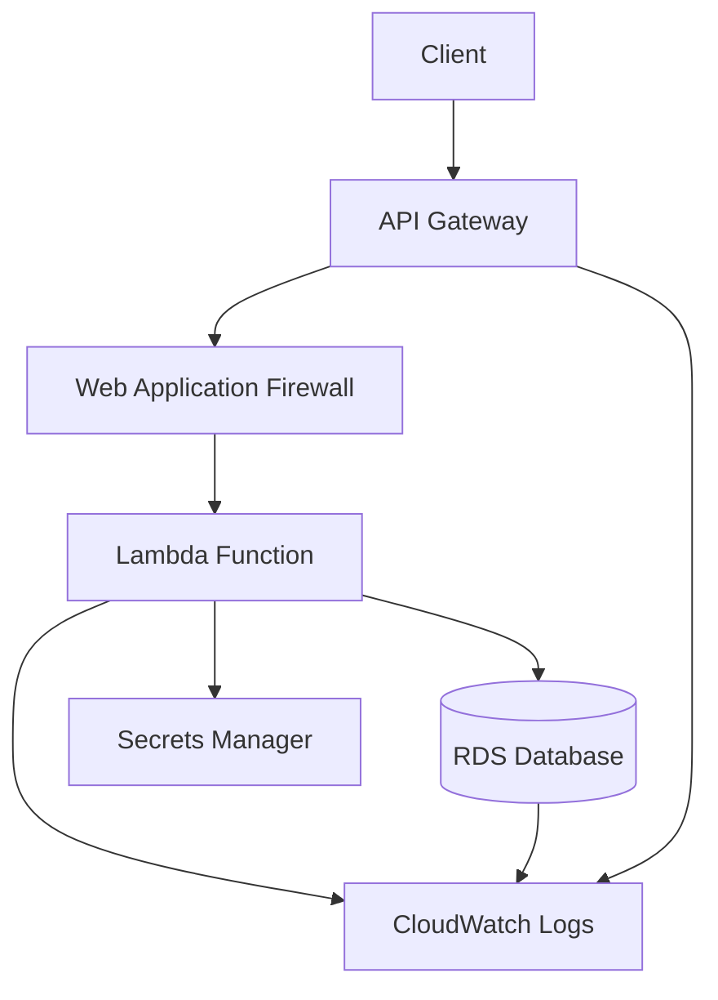

# Serverless Secure Web App (AWS + Terraform)

A production-style serverless API on AWS — Lambda and RDS behind API Gateway, with WAF, least-privilege IAM, and Secrets Manager integrated from the start, not retrofitted.

---

## Architecture

- **API Gateway** — public HTTPS endpoint, protected by WAF
- **Lambda** — backend compute with minimal IAM role
- **RDS (MySQL/Postgres)** — private subnet, encrypted, not publicly accessible
- **Secrets Manager** — handles DB credentials, nothing hardcoded
- **CloudWatch** — centralised logging and metrics



---

## Security Design

- Lambda IAM role scoped to `secretsmanager:GetSecretValue` and `rds-db:connect` only
- RDS in private subnet, encrypted at rest with AWS KMS
- API Gateway protected by AWS WAF with OWASP managed ruleset
- All credentials stored in Secrets Manager — never in environment variables or code
- VPC isolation with public/private subnet separation
- CloudWatch logging enabled across API Gateway and Lambda

---

## Quick Start

### Prerequisites

- AWS account with CLI access
- Terraform >= 1.5
- Python 3.9+

### Deploy

```bash
git clone https://github.com/pantelovich/serverless-secure-webapp.git
cd serverless-secure-webapp
chmod +x deploy.sh
./deploy.sh
```

### Test

```bash
curl https://<api_gateway_url>/prod/time
```

Expected response:

```json
{
  "message": "Successfully retrieved time from database",
  "time": "2025-01-03 12:34:56",
  "timestamp": "2025-01-03T12:34:56.789Z"
}
```

### Manual deployment

```bash
cd infra
terraform init
terraform plan
terraform apply
```

---

## Project Structure

```
serverless-secure-webapp/
├── infra/
│   ├── main.tf
│   ├── variables.tf
│   └── outputs.tf
├── lambda/
│   ├── app.py
│   └── requirements.txt
├── deploy.sh
└── README.md
```

---

## Monitoring

- Lambda logs: `/aws/lambda/serverless-secure-webapp-api`
- API Gateway logs: `/aws/apigateway/serverless-secure-webapp-api`
- WAF metrics: CloudWatch under `AWS/WAFV2`

Useful commands:

```bash
# Tail Lambda logs
aws logs tail /aws/lambda/serverless-secure-webapp-api --follow

# Tail API Gateway logs
aws logs tail /aws/apigateway/serverless-secure-webapp-api --follow
```

---

## Troubleshooting

| Issue | Likely cause |
|-------|-------------|
| Lambda timeout | VPC config or security group misconfiguration |
| Database connection failed | RDS security group not allowing Lambda ingress |
| Secrets Manager access denied | IAM role missing `secretsmanager:GetSecretValue` |
| WAF blocking legitimate requests | Check WAF logs in CloudWatch |

---

## Next Steps

- CI/CD pipeline with GitHub Actions
- Multi-environment deployments (dev/staging/prod)
- API authentication via Cognito
- Custom domain with SSL certificate
- OpenAPI/Swagger documentation

---

## Cleanup

```bash
cd infra && terraform destroy
```

---

## Licence

MIT — see [LICENSE](LICENSE) for details.
